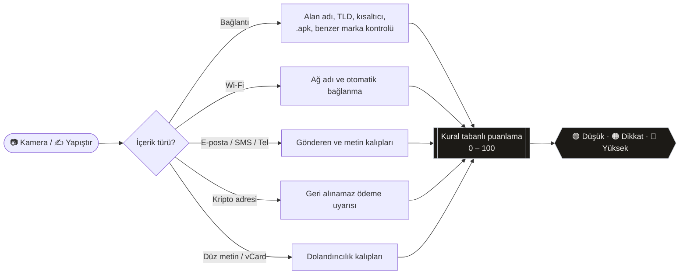
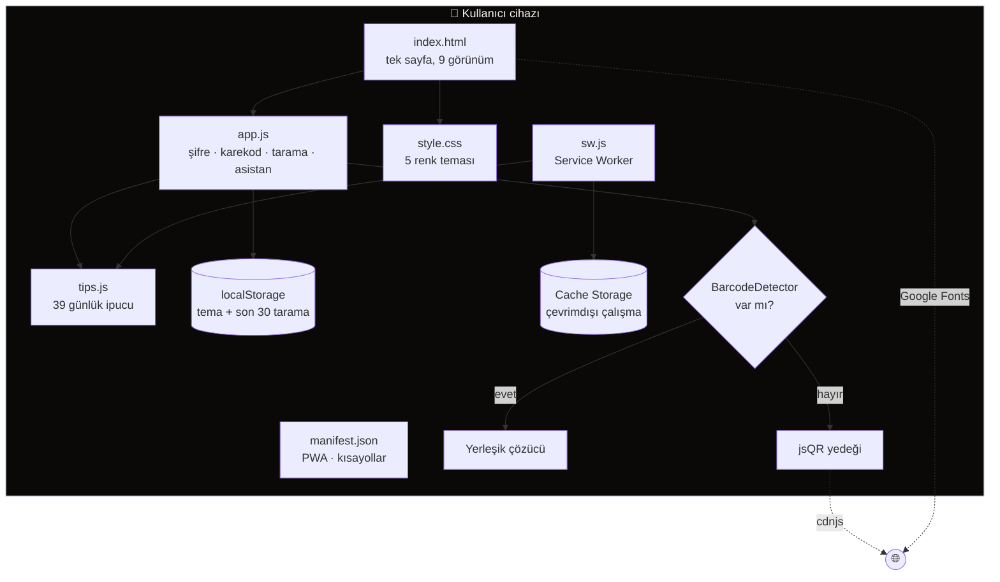
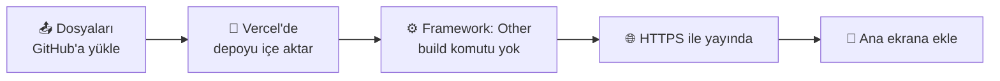

<div align="center">


<br>


**Vatandaşlar için ücretsiz, gizlilik odaklı mobil siber güvenlik rehberi.**
Tarayıcıda çalışır, telefona gerçek bir uygulama gibi yüklenir.

[Özellikler](#-özellikler) · [Gizlilik](#-gizlilik) · [Sınırlar](#-sınırlar) · [Mimari](#-teknik-yapı) · [Kurulum](#-kurulum--yayınlama) · [Lisans](#-lisans)

</div>

---

## 🏛️ Adın Hikâyesi

> *Osmanlı Devleti'nde geceleri şehirlerin güvenliğini sağlayan özel muhafızlara **Ases** denirdi.*

Tehditler artık sokaklarda değil, cihazlarımızın ve verilerimizin sınırlarında geziniyor. ASES, bu köklü nöbet geleneğinden ilham alarak dijital hayatınızda size **bilinçli bir nöbetçi** olmayı hedefler.

<table>
<tr>
<td width="64" align="center">⚠️</td>
<td>

**ASES bir antivirüs değildir.** Telefonunuzdaki uygulamaları, dosyaları veya ağ trafiğini taramaz; arka planda çalışıp sizi korumaz. Bir **bilgilendirme ve farkındalık aracıdır**: size verdiğiniz içeriği (şifre, bağlantı, mesaj, karekod) inceler ve dolandırıcılığa karşı bilgi verir.

</td>
</tr>
</table>

---

## ✨ Özellikler


| | Modül | Ne yapar? |
| :-: | --- | --- |
| 🔒 | **Şifre Sağlığı** | Uzunluk, karmaşıklık, yaygın şifre listesi ve klavye sırası gibi zayıf kalıpları cihazda analiz eder. |
| 📷 | **Karekod Tarama** | Kamerayla okunan karekodun risk seviyesini (düşük / dikkat / yüksek) gösterir. Bağlantı, Wi-Fi, telefon, SMS, e-posta, kripto adresi ve kartvizit içeriklerini tanır. |
| 🔎 | **Tarama** | Şüpheli link veya SMS metnini yapıştırıp risk analizi yaptırır; son 30 tarama cihazda listelenir. |
| 🚨 | **Acil Durum Rehberi** | Hesap çalınması, banka bilgisi sızıntısı, dolandırılma, telefon kaybı ve kimlik taklidi için adım adım yol gösterir. |
| 🛡️ | **Aile Güvenliği** | Ebeveyn kontrolü, izin denetimi ve gizlilik ayarları tavsiyeleri. |
| 💡 | **Farkındalık** | Dolandırıcılık, bankacılık, sosyal medya, Wi-Fi ve genel güvenlik kategorilerinde ipuçları. Her gün sırayla yeni bir **Günün İpucu**. |
| 🦠 | **Virüs Türleri** | Virüs, Trojan, casus yazılım, fidye yazılımı ve oltalama referansı. |
| 💬 | **ASES Asistan** | Cihazda çalışan, anahtar kelime eşleştirmeli yerel sohbet motoru. |
| ✅ | **Hızlı Güvenlik Kontrolü** | Ana sayfada 5 maddelik alışkanlık listesi; işaretledikçe kalkan dolar. |
| 🔔 | **Bildirimler** | Uygulama açıkken tehlikeli karekod / zayıf şifre için yerel bildirim ve günlük ipucu. |
| 🎨 | **Renk Teması** | Gümüş, kırmızı, mavi, yeşil ve mor. |

### 🔄 Karekod ve link analizi nasıl çalışır?




---

## 🔐 Gizlilik


**Toplamıyoruz.** Yazdığınız şifre, yapıştırdığınız bağlantı veya mesaj, taradığınız karekod, sohbet mesajlarınız ve kamera görüntüsü hiçbir sunucuya gönderilmez. Tüm analizler cihazınızda JavaScript ile yapılır. Kayıt, giriş veya hesap yoktur; reklam ve takip aracı kullanılmaz.

**Cihazınızda saklananlar.** Tema tercihiniz, kapatılan banner bilgisi ve son 30 tarama kaydı (kısaltılmış metin ve puan) yalnızca tarayıcının `localStorage` alanında durur. "Temizle" düğmesi veya tarayıcı verilerini silmek bunları kaldırır.

**Dışarıyla temas eden kısımlar (dürüst not):**

| Servis | Neden? | Ne görebilir? |
| --- | --- | --- |
| **Google Fonts** | Yazı tipleri | IP adresiniz |
| **cdnjs (Cloudflare)** | Yedek karekod çözücü (jsQR) | IP adresiniz |
| **Vercel** | Barındırma | Standart sunucu kayıtları (IP, tarayıcı, zaman). Uygulama kişisel içerik göndermez. |

**Kamera** yalnızca "Kamerayı aç" düğmesine bastığınızda ve tarayıcı izin verdiğinde açılır; kod okunduğunda veya pencere kapatıldığında kapanır. Görüntü kaydedilmez.

---

## 🚧 Sınırlar

ASES'in ne yapabildiğini bilmek, ne yapamadığını bilmek kadar önemlidir.

| ✅ Yapar | ❌ Yapmaz |
| --- | --- |
| Verdiğiniz şifreyi, linki, mesajı ve karekodu bilinen kalıplara göre değerlendirir | Telefondaki virüs, casus yazılım veya zararlı uygulamaları **tespit edemez, temizleyemez** |
| Uygulama açıkken yerel bildirim gösterir | **Arka planda çalışmaz**; kapalıyken uyarı gelmez |
| Dolandırıcılığa karşı bilgilendirir | Ağınızı, Wi-Fi bağlantınızı veya diğer uygulamaları **izlemez** |
| Şifre gücünü uzunluk, çeşitlilik ve kalıplara göre ölçer | Şifrenizin **veri sızıntısında olup olmadığını** kontrol etmez |
| Hazır cevaplar arasından anahtar kelimeyle seçer | **Yapay zekâ değildir**; hukuki, finansal veya teknik uzman tavsiyesinin yerini tutmaz |

> [!IMPORTANT]
> Karekod, bağlantı ve mesaj analizleri **kural tabanlı tahmindir**; gerçek bir tehdit veritabanına bağlı değildir. "Düşük risk" sonucu "güvenli" demek değildir, "yüksek risk" de her zaman dolandırıcılık anlamına gelmez.

> [!WARNING]
> Acil Durum Rehberi genel yönlendirmedir. Para kaybı veya hesap ele geçirilmesinde önce bankanızla / ilgili platformla ve yetkili kurumlarla iletişime geçin. Can güvenliği söz konusuysa **112**'yi arayın.

---

## 🧱 Teknik Yapı



- Salt **HTML / CSS / JavaScript**, framework yok, tek sayfa uygulaması
- **Service Worker** ile çevrimdışı çalışma; ilk açılıştan sonra büyük kısmı internetsiz çalışır
- **Web App Manifest** ile "ana ekrana ekle" ve kısayollar (Şifre, Karekod, Acil Durum, Asistan)
- Karekod okuma için tarayıcının yerleşik `BarcodeDetector` özelliği; desteklemeyen tarayıcılarda (iOS Safari, Firefox) [jsQR](https://github.com/cozmo/jsQR) yedeği
- Eski cihaz uyumluluğu için ES5'e çevrilmiş JavaScript ve statik CSS renk yedekleri
- Güvenlik başlıkları: `Content-Security-Policy`, `X-Content-Type-Options`, `Referrer-Policy`, `Permissions-Policy` (kamera yalnızca kendi sayfası)

### 📁 Depo yapısı

```text
.
├── .github/workflows/
│   ├── duzenle.yml        # GitHub Pages'e yayınlar
│   └── tasi.yml           # Kökteki dosyaları site/ içine taşır
├── site/
│   ├── index.html         # Sayfa yapısı ve CSP
│   ├── app.js             # Tüm uygulama mantığı
│   ├── style.css          # Görünüm ve temalar
│   ├── sw.js              # Çevrimdışı çalışma / önbellek
│   ├── tips.js            # Günün ipuçları
│   ├── manifest.json      # PWA bilgileri
│   ├── vercel.json        # Güvenlik başlıkları (Vercel)
│   ├── _headers           # Güvenlik başlıkları (Netlify)
│   └── *.png              # Uygulama simgeleri
├── assets/                # README görselleri
├── License.txt
└── README.md
```

---

## 🚀 Kurulum / Yayınlama

Proje statik dosyalardan oluşur; Vercel, GitHub Pages, Netlify gibi herhangi bir statik barındırmada ücretsiz yayınlanabilir.



1. Bu depodaki dosyaları GitHub deposuna yükleyin.
2. Vercel'de depoyu içe aktarın; **Framework Preset: Other** seçin, build komutu gerekmez. (GitHub Pages için `duzenle.yml` iş akışı `site/` klasörünü yayınlar.)
3. Siteyi mobil tarayıcıda açın. Kamera ve PWA için HTTPS gerekir; Vercel bunu otomatik sağlar.
4. Tarayıcı menüsünden **"Ana ekrana ekle"** ile telefona yükleyin.

> [!TIP]
> **Güncelleme yaparken:** dosyaları değiştirdikten sonra `site/sw.js` içindeki `CACHE_NAME` sürümünü artırın (ör. `ases-v16` → `ases-v17`). Aksi halde kullanıcılar eski önbelleği görmeye devam edebilir. Yeni günlük ipucu eklemek için `tips.js` listesinin sonuna bir satır eklemeniz yeterlidir.

---

## 📜 Lisans

Bu proje **özel mülkiyetlidir. Tüm hakları saklıdır.** Kaynak kodun kopyalanması, değiştirilmesi, türev çalışma üretilmesi ve "ASES" markasının izinsiz kullanımı yasaktır. Ayrıntılar için [`License.txt`](./License.txt) dosyasına bakınız.

## 📬 İletişim

Telif hakkı, iş birliği ve lisans sorguları için proje sahibiyle iletişime geçiniz.

<div align="center">


**Furkan Özkan** · Proje Sahibi

<sub>© 2026 ASES — Dijital hayatında nöbet tutar.</sub>

</div>
