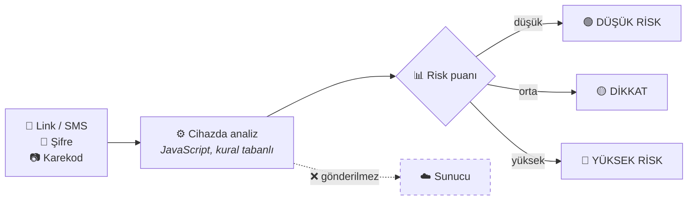
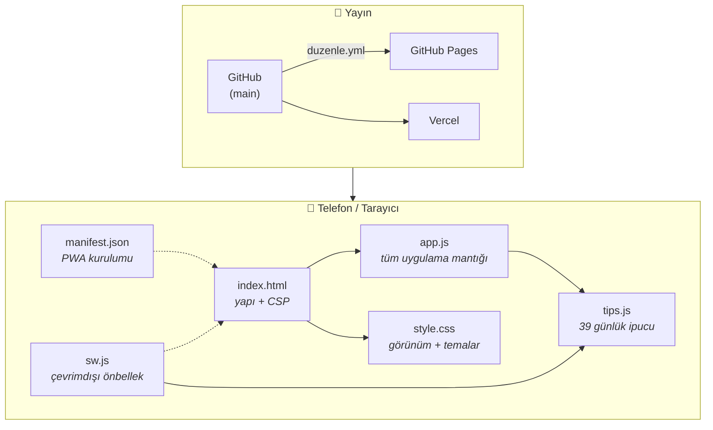

<div align="center">


<br>


**Vatandaşlar için ücretsiz, gizliliğe saygılı mobil siber güvenlik rehberi.**
<br>
Tarayıcıda çalışır, telefona gerçek bir uygulama gibi yüklenir.

[Özellikler](#-özellikler) •
[Gizlilik](#-gizlilik) •
[Sınırlar](#%EF%B8%8F-asesin-sınırları) •
[Teknik Yapı](#%EF%B8%8F-teknik-yapı) •
[Kurulum](#-kurulum--yayınlama) •
[Lisans](#-lisans)

</div>


## 🦅 ASES Nedir?

**ASES**, adını Osmanlı Devleti'nde geceleri şehirlerin güvenliğini sağlayan özel muhafızlardan alır. Bugün o nöbeti dijital dünyada tutmaya çalışır: şifreni, bağlantını, mesajını ve karekodunu incelemene yardım eder, dolandırıcılığa karşı seni bilgilendirir.

> [!IMPORTANT]
> **ASES bir antivirüs değildir.** Telefondaki uygulamaları, dosyaları veya ağ trafiğini taramaz; arka planda çalışıp seni korumaz. ASES bir **bilgilendirme ve farkındalık aracıdır**: senin verdiğin içeriği (şifre, bağlantı, mesaj, karekod) inceler ve riskler hakkında bilgi verir.

<br>

## 📊 Bir Bakışta

<div align="center">

| 🧩 | 🎨 | 💡 | 🔐 | 📴 |
|:---:|:---:|:---:|:---:|:---:|
| **9** | **5** | **39** | **0** | **✔** |
| Ekran / modül | Renk teması | Günlük ipucu | Sunucuya giden kişisel veri | Çevrimdışı çalışma desteği |

</div>

<br>

## ✨ Özellikler

<table>
  <tr>
    <td width="50%" valign="top">
      <h3>🔒 Şifre Sağlığı</h3>
      Şifreni <b>tamamen cihazında</b> analiz eder: uzunluk, karmaşıklık, yaygın şifre listeleri ve klavye sırası gibi zayıf kalıplar. Hiçbir şifre sunucuya gönderilmez.
    </td>
    <td width="50%" valign="top">
      <h3>📷 Karekod Tarama</h3>
      Kamerayla taranan karekodun risk seviyesini gösterir. Bağlantı, Wi-Fi, telefon, SMS, e-posta, kripto adresi ve kartvizit içeriklerini tanır.
    </td>
  </tr>
  <tr>
    <td valign="top">
      <h3>🔎 Tarama</h3>
      Şüpheli link veya SMS/mesaj metnini yapıştır, risk analizini gör. Son taramalar yalnızca cihazında listelenir.
    </td>
    <td valign="top">
      <h3>💡 Farkındalık</h3>
      Dolandırıcılık, bankacılık, sosyal medya ve Wi-Fi güvenliği hakkında kategorilere ayrılmış ipuçları ve her gün değişen <b>Günün İpucu</b>.
    </td>
  </tr>
  <tr>
    <td valign="top">
      <h3>🚨 Acil Durum Rehberi</h3>
      Hesabın çalındıysa, banka bilgilerin sızdıysa ya da telefonunu kaybettiysen adım adım yol gösterir ve resmi başvuru kanallarına yönlendirir.
    </td>
    <td valign="top">
      <h3>👨‍👩‍👧 Aile Güvenliği</h3>
      Ebeveynler için çocuğun cihazında ebeveyn kontrolü, izin denetimi ve gizlilik ayarları tavsiyeleri.
    </td>
  </tr>
  <tr>
    <td valign="top">
      <h3>🦠 Virüs Türleri</h3>
      Virüs, Trojan, casus yazılım, fidye yazılımı ve oltalama hakkında sade bir referans bilgisi.
    </td>
    <td valign="top">
      <h3>🤖 ASES Asistan</h3>
      Cihazda çalışan, anahtar kelime eşleştirmeli yerel sohbet motoru. Hiçbir mesaj dışarıya gönderilmez.
    </td>
  </tr>
  <tr>
    <td valign="top">
      <h3>🛡️ Hızlı Güvenlik Kontrolü</h3>
      Ana sayfada 5 temel güvenlik alışkanlığını işaretlediğin, dolan kalkan göstergeli bir kontrol listesi.
    </td>
    <td valign="top">
      <h3>🔔 Bildirimler</h3>
      Uygulama açıkken tehlikeli görünen bir karekod ya da zayıf şifre tespit edilirse yerel bildirim gösterir. Günlük ipucu bildirimi de uygulama açılınca gelir.
    </td>
  </tr>
</table>

### 🎨 Renk Temaları

Uygulama beş vurgu rengiyle kişiselleştirilebilir:


<br>

## 🧭 Nasıl Çalışır?

Tarama, karekod ve şifre analizleri **kural tabanlıdır** ve baştan sona cihazında çalışır:



<br>

## 🔐 Gizlilik


> [!NOTE]
> Kayıt, giriş veya hesap yoktur. Reklam ve takip aracı kullanılmaz.

<table>
  <tr>
    <th width="33%">✅ Toplamıyoruz</th>
    <th width="33%">📱 Cihazında saklananlar</th>
    <th width="34%">🌐 Dışarıyla temas edenler</th>
  </tr>
  <tr>
    <td valign="top">
      • Yazdığın şifre<br>
      • Yapıştırdığın bağlantı veya mesaj<br>
      • Taradığın karekod<br>
      • Sohbet mesajların<br>
      • Kamera görüntüsü
      <br><br>
      <sub>Hiçbiri hiçbir sunucuya gönderilmez.</sub>
    </td>
    <td valign="top">
      • Tema tercihin<br>
      • Kapatılan banner bilgisi<br>
      • Son 30 tarama kaydı <sub>(kısaltılmış metin ve puan)</sub>
      <br><br>
      <sub>Yalnızca tarayıcının <code>localStorage</code> alanında durur. <b>Temizle</b> düğmesi veya tarayıcı verilerini silmek bunları kaldırır.</sub>
    </td>
    <td valign="top">
      • <b>Google Fonts</b>: yazı tipleri yüklenirken IP adresin görülebilir<br>
      • <b>cdnjs (Cloudflare)</b>: yedek karekod çözücü (jsQR) yüklenirken IP adresin görülebilir<br>
      • <b>Vercel</b>: standart sunucu kayıtları (IP, tarayıcı, istek zamanı) tutulabilir
      <br><br>
      <sub>Uygulama bu kayıtlara kişisel içerik göndermez.</sub>
    </td>
  </tr>
</table>

**📷 Kamera:** Yalnızca "Kamerayı aç" düğmesine bastığında ve tarayıcı izin verdiğinde açılır; karekod okunduğunda veya pencere kapatıldığında kapanır. Görüntü kaydedilmez.

İlk açılıştan sonra uygulamanın büyük kısmı çevrimdışı çalışır.

<br>

## ⚠️ ASES'in Sınırları

Dürüst olalım: ASES her derde deva değildir.

<table>
  <tr>
    <th width="50%">✅ ASES yapar</th>
    <th width="50%">❌ ASES yapamaz</th>
  </tr>
  <tr>
    <td valign="top">
      • Verdiğin içeriği cihazında inceler<br>
      • Bilinen dolandırıcılık kalıplarına göre risk puanı verir<br>
      • Zayıf şifre kalıplarını gösterir<br>
      • Acil durumda sana yol haritası sunar<br>
      • Farkındalık bilgisi ve ipuçları paylaşır
    </td>
    <td valign="top">
      • Telefondaki virüs, casus yazılım veya zararlı uygulamaları <b>tespit edemez, temizleyemez</b><br>
      • Ağını, Wi-Fi bağlantını veya diğer uygulamaları <b>izlemez</b><br>
      • <b>Arka planda çalışmaz</b>; uygulama kapalıyken uyarı gelmez<br>
      • Gerçek bir tehdit veritabanına bağlı değildir<br>
      • Şifrenin veri sızıntısında olup olmadığını <b>kontrol etmez</b>
    </td>
  </tr>
</table>

> [!WARNING]
> "Düşük risk" sonucu **"güvenli"** demek değildir; "yüksek risk" sonucu da her zaman dolandırıcılık olduğu anlamına gelmez. Sonuçlar kural tabanlı tahmindir.

- **ASES Asistan** bir yapay zekâ değildir; hazır cevaplar arasında anahtar kelimeyle seçim yapar. Hukuki, finansal veya teknik uzman tavsiyesinin yerini tutmaz.
- **Acil Durum Rehberi** genel yönlendirmedir. Para kaybı veya hesabının ele geçirilmesi durumunda önce bankanla / ilgili platformla ve yetkili kurumlarla iletişime geç. Can güvenliği söz konusuysa **112**'yi ara.

<br>

## 🛠️ Teknik Yapı


- Salt **HTML / CSS / JavaScript** (framework yok), tek sayfa uygulaması
- **Service Worker** ile çevrimdışı çalışma
- **Web App Manifest** ile "ana ekrana ekle" / PWA kurulumu
- Karekod okuma: tarayıcının yerleşik `BarcodeDetector` özelliği; desteklemeyen tarayıcılarda (iOS Safari, Firefox gibi) yedek olarak [jsQR](https://github.com/cozmo/jsQR)
- Eski cihaz/tarayıcı uyumluluğu için ES5'e çevrilmiş JavaScript ve statik CSS renk yedekleri



### 📁 Proje Dizini

```text
.
├── .github/
│   ├── assets/               # README görselleri (banner, logo, ayraç)
│   └── workflows/
│       ├── duzenle.yml       # GitHub Pages'e otomatik yayın
│       └── tasi.yml          # Kökteki dosyaları site/ içine taşır (elle çalıştırılır)
├── site/                     # Yayınlanan tüm site dosyaları
│   ├── index.html            # Sayfa yapısı ve güvenlik (CSP) ayarı
│   ├── app.js                # Tüm uygulama mantığı
│   ├── tips.js               # Günün ipuçları
│   ├── style.css             # Görünüm ve temalar
│   ├── sw.js                 # Çevrimdışı çalışma / önbellek
│   ├── manifest.json         # PWA kurulum bilgileri
│   ├── vercel.json           # Güvenlik başlıkları (Vercel)
│   ├── _headers              # Güvenlik başlıkları (Netlify)
│   └── icon-*.png            # Uygulama simgeleri
├── License.txt
└── README.md
```

<br>

## 🚀 Kurulum / Yayınlama

Proje yalnızca statik dosyalardan oluşur; Vercel, GitHub Pages, Netlify gibi servislerde ücretsiz yayınlanabilir. Build komutu gerekmez.

<table>
  <tr>
    <td width="50%" valign="top">
      <h3>▲ Vercel</h3>
      <ol>
        <li>Depoyu Vercel'de içe aktar.</li>
        <li><b>Root Directory</b> olarak <code>site</code> klasörünü seç.</li>
        <li><b>Framework Preset:</b> <code>Other</code>, build komutu boş.</li>
        <li>Siteyi mobil tarayıcıda aç (kamera ve PWA için HTTPS gerekir, Vercel bunu otomatik sağlar).</li>
      </ol>
    </td>
    <td width="50%" valign="top">
      <h3>🐙 GitHub Pages</h3>
      <ol>
        <li><b>Settings → Pages → Source</b> kısmında <code>GitHub Actions</code>'ı seç.</li>
        <li><code>main</code> dalına yapılan her push, <code>duzenle.yml</code> ile siteyi otomatik yayınlar.</li>
        <li><code>site/</code> klasörü varsa o, yoksa depo kökü yayınlanır.</li>
      </ol>
    </td>
  </tr>
</table>

📲 **Telefona yüklemek için:** tarayıcı menüsünden **"Ana ekrana ekle"** seçeneğini kullan.

<details>
<summary><b>🔄 Güncelleme yaparken (önemli)</b></summary>

<br>

Dosyaları değiştirdikten sonra `site/sw.js` içindeki `CACHE_NAME` sürümünü artır, aksi halde kullanıcılar eski önbelleği görmeye devam edebilir:

```diff
- var CACHE_NAME = "ases-v16";
+ var CACHE_NAME = "ases-v17";
```

</details>

<br>

## 📜 Lisans

Bu proje **özel mülkiyetlidir — tüm hakları saklıdır.** Ayrıntılar için [`License.txt`](./License.txt) dosyasına bakınız.

Telif hakkı, iş birliği ve lisans sorguları için proje sahibiyle iletişime geçiniz.

<br>


<div align="center">


**ASES — Mobil Siber Güvenlik**

Bilinçli kullanıcı, güvenli dijital hayat. 🛡️

<sub>**Furkan Özkan** — Proje Sahibi</sub>
<br>
<sub>© 2026 Furkan Özkan. Tüm hakları saklıdır.</sub>

</div>
